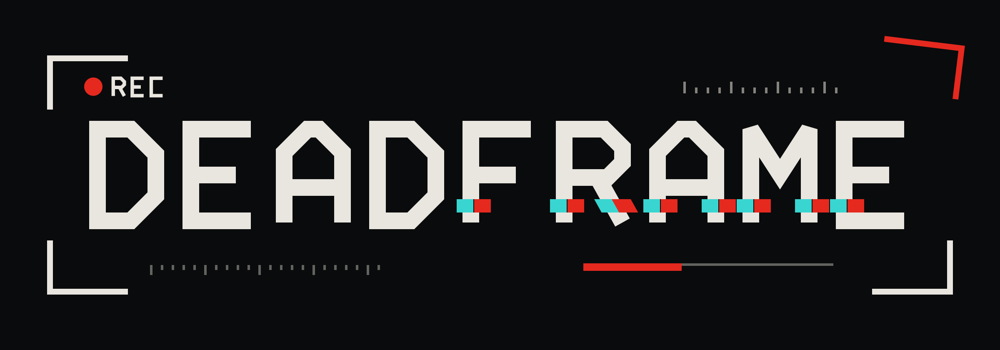

# DEADFRAME



FPS « bodycam » : caméra de poitrine fisheye, visée libre sans viseur, drone de reconnaissance, bots, multijoueur LAN. Prototype sans moteur externe (WebGL2 + Go).

## Jouer
- **Dans le navigateur (solo contre les bots)** : GitHub Pages sert `index.html` à la racine du dépôt.
- **Multijoueur** : télécharger [`download/DEADFRAME.exe`](download/DEADFRAME.exe) (Windows 64 bits). Il démarre un serveur sur le port 7777, ouvre le jeu et affiche l'adresse à donner aux amis du même réseau (ex. `http://192.168.1.20:7777`). Eux n'ont besoin que d'un navigateur.
  - Premier lancement : autoriser le pare-feu ; SmartScreen peut avertir (exe non signé) → « Informations complémentaires » → « Exécuter quand même ».
  - Options : `DEADFRAME.exe -port 9000 -noopen` (serveur dédié).

## Commandes (clavier AZERTY)
ZQSD déplacement · Maj sprint · Espace saut · C accroupi · A/E se pencher · clic gauche tir · clic droit visée · R recharger · 1–4 arme (HK416, AKS-74, AKM, P43) · V inspecter l'arme · F lampe · G drone · Tab scores · Échap menu.
Drone : ZQSD, Espace/C altitude, G reprendre la main, F rappel.

## Structure
| Chemin | Rôle |
|---|---|
| `index.html` | Le jeu, généré depuis `src/game.html` par `src/build.py` |
| `assets/` | Modèles `.dfm` + textures, générés par `tools/convert.py` depuis les `.glb` d'origine |
| `src/game.html` | Tout le jeu : moteur WebGL2, shaders, IA, audio, réseau |
| `main.go` | Serveur HTTP + relais WebSocket (bibliothèque standard), embarque `index.html` et `assets/` |
| `tools/convert.py` | Convertisseur glTF → `.dfm` (décimation, squelette, animations) |
| `logo/` | Logo et icône |

## Compiler
```
python3 src/build.py
GOOS=windows GOARCH=amd64 go build -trimpath -ldflags "-s -w" -o download/DEADFRAME.exe .
```

## Limites connues
- Rendu stylisé (décors en blocs, textures procédurales, pas d'ombres portées).
- Le soldat n'a pas de squelette : marche simulée par déformation des jambes.
- AKM : seul le fusil est utilisé (les bras du fichier d'origine sont inexploitables) ; l'AKS-74 a ses bras et animations d'origine.
- Réseau : relais simple, dégâts déclarés par le tireur (pas d'anti-triche). Par Internet : rediriger le port 7777 ou VPN type LAN.

## Crédits
Modèles 3D sous licence CC BY 4.0 — voir [CREDITS.md](CREDITS.md).
