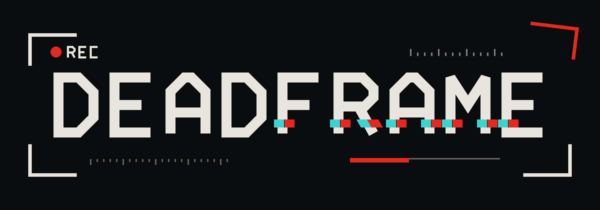

# DEADFRAME



FPS « bodycam » : caméra de poitrine fisheye, visée libre sans viseur, drone de reconnaissance, bots, multijoueur LAN. Prototype sans moteur externe (WebGL2 + Go).

## Jouer
- **En ligne (Internet)** : ouvrir la page GitHub Pages (`https://haze15.github.io/DEADFRAME/`) ou directement l'adresse du serveur hébergé. Le jeu rejoint automatiquement le serveur public ; une autre adresse peut être saisie dans DEPLOY → « Serveur en ligne ». Tout le monde joue dans la même partie (16 joueurs max) ; le premier connecté est l'hôte (carte et bots).
- **Réseau local** : `download/DEADFRAME.exe` (Windows 64 bits) démarre un serveur sur le port 7777, ouvre le jeu et affiche l'adresse à donner aux amis du même réseau. Premier lancement : autoriser le pare-feu ; SmartScreen peut avertir (exe non signé).
- La page publiée dans Claude reste en solo : elle ne peut pas ouvrir de connexion vers un autre site.
- **Téléphone et tablette** : même page, commandes tactiles automatiques (à tenir en paysage). Joystick gauche : se déplacer (poussé à fond vers l'avant : sprint) · glisser sur la moitié droite : viser · TIR (se fait aussi glisser pour viser) · VISÉE, ACCR. (bascules) · SAUT · RECH. (maintenu : vérifier le chargeur) · ARME · DRONE · LAMPE · MENU. En drone : joystick gauche gaz / lacet (en ACRO les gaz restent où on les laisse, comme sur une radio), joystick droit tangage / roulis, boutons MODE, RETOURNER, RAPPEL, SORTIR. Réglage dans SETTINGS → Contrôles → « Commandes tactiles » (auto / toujours / jamais).

## Serveur hébergé (Render, gratuit)
Le fichier `render.yaml` décrit le service : Render construit le serveur Go (le jeu est intégré dans le binaire) à chaque push sur `main`.
1. Créer un compte sur https://render.com avec « Sign in with GitHub ».
2. New → Blueprint → choisir le dépôt `Haze15/DEADFRAME` → Apply.
3. Une fois déployé, Render affiche l'adresse (ex. `https://deadframe.onrender.com`). Si elle diffère, mettre à jour `ONLINE_SERVER` dans `src/game.html`.
- Mode public (activé d'office sur Render via la variable `PORT`) : pas d'arrêt à distance, pas d'adresses internes, 16 joueurs, débit limité à 90 messages/s par joueur.
- Offre gratuite : le serveur se met en veille après 15 min sans connexion et met jusqu'à une minute à se réveiller (le menu l'indique).
- Pas d'anti-triche : les dégâts sont déclarés par le tireur.

## Menu principal
- **DEPLOY** : zone d'opération (la scène en arrière-plan suit la carte choisie), nombre d'hostiles, adresse réseau à donner aux amis, bouton Déployer (ou Entrée).
- **LOADOUT** : arme en main à chaque insertion (les cinq restent accessibles en jeu avec 1–5) et dotation fixe.
- **OPERATORS** : indicatif, niveau, grade, états de service, connexion Discord.
- **MISSIONS** : 15 contrats permanents suivis sur toutes les parties (éliminations par arme, par carte, tirs à la tête, série, temps de vol du drone), chacun récompensé en XP.
- **SETTINGS** : affichage, contrôles, audio, touches, crédits.
- **QUIT** : en partie, « Quitter la partie » ramène au menu ; « Quitter le jeu » ferme la fenêtre et, avec `DEADFRAME.exe`, arrête aussi le serveur (uniquement depuis le PC qui l'héberge).
- Progression : 100 XP par élimination, +50 à la tête, plus les contrats. Grades de Recrue (niv. 1) à Major (niv. 42). Enregistrée dans le navigateur (localStorage) : elle ne suit pas d'un navigateur ou d'un PC à l'autre.
- Navigation : souris, ↑/↓ + Entrée, ou croix de la manette + A.

## Cartes
Dépôt industriel · Hôpital abandonné · Tranchées · Hôtel · Front — choix dans le menu (en multijoueur, c'est l'hôte qui choisit).
- **Dépôt industriel** : entrepôt à rayonnages chargés (palettes, cartons, fûts), chariot élévateur, **mezzanine** accessible par un escalier (vue sur l'entrepôt, garde-corps qui couvre à moitié), quai de chargement avec remorque à quai, portique à conteneurs au-dessus du parc, château d'eau, bureaux meublés, garage avec pont élévateur, poste de garde avec barrière levante, clôture barbelée et silhouettes d'usines dans le brouillard.
- **Tranchées** : parois coffrées en planches, **parapets bas en sacs de sable** sur la première ligne et **banquettes de tir** (50 cm) : debout dessus, on vise par-dessus les sacs ; accroupi, on est à couvert. On sort de la tranchée en sautant depuis la banquette. Lanternes le long des lignes, caisses de munitions, trous d'obus dans le no man's land, barbelés plus denses, deux canons de campagne à l'arrière.
- **Hôtel** : hall à lustre et tapis, comptoir, salon et fauteuils, restaurant avec chaises et bar (tabourets, bouteilles), cuisine (fourneaux, hotte, plonge), salle de réunion, chambres meublées (lampes de chevet, commode et télévision, rideaux), couloir moquetté avec appliques et sorties de secours. **Escalier de secours** sur la façade est (cinq volées) jusqu'au **toit** : acrotère, édicule, climatiseurs, réservoir, antenne. Balcons en façade, transats et parasols autour de la piscine, filet de tennis, haies.
- **Ombres** : chaque lampe de la carte projette des ombres (calculées une fois au chargement, réparties sur les premières images).
- **Hôpital abandonné** : modèle 3D complet fourni (trois niveaux, cour, parking aux voitures abandonnées, arbres). Les collisions sont calculées depuis la géométrie du modèle (`tools/hopital.py` : cases de 20 × 10 × 20 cm fusionnées en boîtes) ; on enjambe les obstacles de 75 cm au plus (sans pouvoir escalader un mur marche après marche). Les deux escaliers mènent au premier étage. Les collisions passent par une grille de 4 m, ce qui garde les tirs et déplacements rapides malgré les 13 000 boîtes.

### Front (décor en modèles 3D, sol en relief)
Deux lignes de tranchées face à face (coffrage en planches, caillebotis, parapets de sacs de sable, lanternes), reliées par des T, un croisement et un boyau vers l'arrière ; un no man's land de 34 trous d'obus avec flaques, deux maisons en ruine (un feu brûle dans chacune) et des arbres morts.
- **Couverts du no man's land** : une épave de char (8 m), deux canons de campagne, six nids de sacs de sable (1,25 m, ouverts à l'arrière), quatre piles de rondins (1,1 m), huit chevaux de frise barbelés devant les lignes et deux piles de caisses de munitions. Tous arrêtent les balles à hauteur d'un tireur accroupi ; les bots les contournent.
- **Sol en relief** : la carte des hauteurs `assets/fr_hf.bin` (pas de 12,5 cm) remplace le sol plat. On tombe dans les tranchées, les parois arrêtent les joueurs, les bots et les balles ; on en sort par les **rampes** (trois vers le no man's land et une vers l'arrière pour chaque ligne, plus les deux bouts). Un saut ne suffit pas pour remonter une paroi de 2 m. Les sacs de sable arrêtent les balles et se franchissent en sautant.
- **Collisions** : murs des ruines et troncs en boîtes invisibles, gravats et cratères dans le relief. Les bots naviguent sur le relief (pas de marche de plus de 30 cm).
- **Chargement** : les modèles (~8 Mo) ne sont téléchargés que lorsqu'on choisit la carte.
- **Régénérer** : `sh tools/modeles/construire.sh` (python3, numpy, pillow, scipy) refait tous les modèles, `assets/fr_*` et les données de la carte dans `src/game.html`, à l'identique (graines fixes). La disposition se règle dans `tools/modeles/make_front.py` (tuiles sur une grille de 8 m, ruines, arbres, lanternes, points d'apparition).

## Commandes (clavier AZERTY)
ZQSD déplacement · Maj sprint · Espace saut · C accroupi · A/E se pencher · clic gauche tir · clic droit visée · R recharger · 1 / 2 arme principale / pistolet · 3 ou V couteau · 4 grenade · 5 flash · I inspecter l'arme · F lampe · G drone · Tab scores · Échap menu.

**Munitions** : aucun compteur à l'écran. R bref = recharger ; R maintenu = l'arme se penche et le compte s'affiche à côté d'elle (X maintenu à la manette). Aucun viseur ni point de visée : seuls les organes de visée comptent.

**Classes** (LOADOUT) — la classe fixe les armes, les grenades et la vitesse ; changée en partie, elle s'applique au prochain déploiement :
- **ASSAUT** : fusil au choix (HK416, AKS-74, AKM) + P43, 2 grenades à fragmentation, 1 flash.
- **BOUCLIER** : bouclier balistique tenu à gauche + P43, 2 flashs, 80 % de vitesse, pas de sprint. Le bouclier arrête les balles qui le touchent (joueurs et bots, étincelles et ricochet) et les trois quarts des éclats de grenade venant de face ; les autres joueurs le voient porté devant le soldat.
- **MITRAILLEUR** : mitrailleuse ML-100 (bande de 100 coups, rechargement 5,4 s) + P43, 1 grenade à fragmentation, 86 % de vitesse.
- **TIREUR D'ÉLITE** : LUNARIS + P43, 1 flash.
- **SAPEUR** : AKS-74 + P43, 1 grenade à fragmentation et 3 **mines de proximité** (touche 6, croix ← à la manette, bouton GREN. en tactile). La mine est posée au sol devant soi (le sapeur s'arrête presque le temps de la poser), s'arme au bout de 2 s (bip), puis saute quand un ennemi passe à moins de 1,6 m (double bip, 0,35 s pour réagir) : jusqu'à 160 de dégâts, 5,5 m de rayon, un mur protège. Une balle la fait sauter. 3 mines posées au plus (la plus ancienne est retirée). Le poseur ne la déclenche pas mais reste exposé à l'explosion. Mines et explosions sont partagées en ligne.
- Pour tous : **couteau** (V ou 3) — 120 de dégâts dans le dos, 55 de face, arrêté par un bouclier de face. **Grenades** : 4 fragmentation (3,2 s, éclats jusqu'à 8 m, un mur protège), 5 flash (1,8 s, éblouit selon la distance, la ligne de vue et la direction du regard, sifflement d'oreilles ; les bots éblouis cessent de tirer). Les grenades rebondissent sur les murs et le sol et sont vues par tous en ligne. Touches 1 / 2 : arme principale / pistolet. Inspecter l'arme passe sur I.
- Manette : croix ← grenade à fragmentation, croix → flash, R3 couteau. Tactile : boutons COUT. et GREN.

**Armes** : HK416, AKS-74 (bras et animations d'origine), AKM, P43, et le fusil de précision **LUNARIS** (.338, 5 coups, un tir au buste est mortel). Le HK416, l'AKM, le P43 et le LUNARIS sont tenus par les bras gantés du modèle AKM : les mains sont replacées sur chaque arme par cinématique inverse (poignée, garde-main), la main gauche va chercher le chargeur pendant le rechargement, la main droite manœuvre le verrou du LUNARIS après chaque tir.
- **Visée** : hors visée, l'arme est tenue comme une caméra de poitrine la voit (en bas à droite, elle suit le regard avec un léger retard). En visée, l'œil se place derrière l'arme : la ligne cran de mire → guidon (mesurée sur chaque modèle) est tournée sur l'axe de la caméra, donc cran, guidon et cible forment une ligne droite au centre de l'image, qui est aussi la direction du tir. HK416 : point holographique au centre ; LUNARIS : lunette.
- **LUNARIS** : clic droit = lunette x8 (réticule gradué) ; la respiration et le pouls font dériver le réticule, Maj le stabilise 5 s puis il faut reprendre son souffle ; sans lunette, le tir est très imprécis.
- **Sons** : coups de feu synthétisés par arme (claquement supersonique, souffle, grave, mécanisme), réverbération courte à l'intérieur et longue avec écho à l'extérieur, son retardé et assourdi avec la distance, claquement et sifflement des balles qui passent près, douilles qui rebondissent, impacts sur les murs et sur les corps, déclic de touche.
- **Sang** : brume et gouttes à l'impact, éclaboussures sur le mur ou le sol derrière la cible, flaque qui s'étend sous les corps, projections sur l'objectif de la caméra quand on est touché.
- **Adversaires animés** : marche avant, arrière et de côté selon leur déplacement, course, accroupi, visée haut / bas, recul au tir, rechargement visible (les bots vident leur chargeur de 30 puis rechargent), sursaut à l'impact, mort en deux temps (les genoux lâchent, puis le corps tombe). Les joueurs en ligne tiennent l'arme qu'ils ont réellement en main.

**Drone FPV « CORBEAU-1 » — simulateur physique**
- Gabarit FPV « 5 pouces » renforcé : 0,72 kg, poussée de 7 fois son poids, moteurs à 15 cm du centre qui répondent en 20 ms, rotations jusqu'à 700°/s en ACRO. Au clavier, les touches poussent les manches progressivement (comme un manche analogique) au lieu d'un tout-ou-rien. Caméra FPV grand angle relevée de 27° en ACRO, ombre au sol et poussière soulevée près du sol.
- Physique de quadrirotor intégrée à 240 Hz : 4 moteurs indépendants avec montée et descente en régime, poussée proportionnelle au carré de leur vitesse ; roulis et tangage naissent des écarts de poussée, le lacet de la réaction des hélices. Gravité 9,81 m/s², inertie et effet gyroscopique, traînée calculée sur la vitesse par rapport à l'air (plus forte à plat qu'en piqué), vent et turbulences, effet de sol, perte de poussée dans son propre souffle en descente verticale. En virage, la poussée inclinée ne porte plus tout le poids : le drone perd de l'altitude si on ne remet pas des gaz.
- **ANGLE** (stabilisé) : les manches commandent l'inclinaison (55° max) et le drone se remet à plat seul. Gaz au neutre = poussée de vol stationnaire à plat, avec une légère tenue de la vitesse verticale (qui ne compense pas les virages).
- **ACRO** (manuel) : les manches commandent les vitesses de rotation (jusqu'à 700°/s), rien n'est stabilisé, les gaz sont manuels et restent en place. C'est le mode des saltos et tonneaux (comptés à l'écran et dans le contrat « Voltigeur »).
- Clavier : G lancer / prendre / rendre la main · T mode ANGLE/ACRO · Z/S tangage · Q/D roulis · A/E lacet · Espace/Ctrl gaz · Maj plein gaz · souris : lacet + caméra (ANGLE) ou tangage + roulis (ACRO) · ↑/↓ inclinaison caméra · molette zoom · X retourner un drone sur le dos · F rappel · Échap quitter.
- Manette (mode 2) : stick gauche gaz/lacet (neutre = stationnaire) · stick droit tangage/roulis · RT plein gaz · Y mode · A retourner · LB/RB caméra · croix ←/→ zoom · ↓ rappel · B quitter.
- Caméra FPV solidaire du châssis (inclinaison réglable), vibrations selon la charge des moteurs et les dégâts, flou et champ qui s'élargissent avec la vitesse, souffle du vent qui monte avec la vitesse, son de chacun des 4 moteurs.
- Pilote automatique (décollage, stationnaire quand on rend la main, retour si liaison perdue ou rappel, atterrissage sur batterie critique) : il passe par la même physique. Chocs : dégâts, et destruction au-delà d'environ 40 km/h d'impact.
- Clavier QWERTY : utilise C plutôt que Ctrl pour baisser les gaz (Ctrl+W ferme l'onglet).

**Manette** (Xbox / PlayStation, disposition standard) : stick gauche bouger · stick droit viser · RT tir · LT visée · A saut · B accroupi · X recharger (maintenu : chargeur) · Y arme suivante · LB/RB se pencher · L3 sprint · R3 couteau · croix ↑ drone, ↓ lampe, ← grenade, → flash · Start menu · Select scores.

## Connexion Discord
Le menu « Opérateur » propose « Se connecter avec Discord » (OAuth2 *implicit grant*, scope `identify` : pseudo et avatar, aucun secret dans le jeu).
1. Créer une application sur https://discord.com/developers/applications.
2. Dans OAuth2 → Redirects, ajouter l'adresse exacte du jeu : `https://haze15.github.io/DEADFRAME/` et/ou `http://localhost:7777/`.
3. Coller l'ID d'application (Client ID) dans le menu, ou le mettre dans la constante `DISCORD_CLIENT_ID` de `src/game.html` pour que tous les joueurs l'aient.
Limites : le pseudo n'est pas vérifié par le serveur de jeu (un joueur peut toujours taper un autre indicatif) ; ne fonctionne pas dans une page intégrée (iframe).

## Performances
Qualité « Automatique » : la résolution interne s'ajuste pour viser 60 i/s.

**Champ de vision** : seul ce que la caméra voit est dessiné. La carte est découpée en secteurs de 12 m (les très grands blocs — sol, murs d'enceinte, toits — forment leur propre secteur) ; à chaque image, la pyramide de vision exacte de la caméra (champ, inclinaison, roulis, fisheye compris) est comparée aux boîtes des secteurs et des objets : personnages, drones, débris, particules, impacts, traçantes. Ce qui est hors champ n'est ni envoyé ni calculé par la carte graphique. Le pourcentage de carte dessiné s'affiche dans le coin de la caméra (« CHAMP »).
- **Lumières** : seules comptent celles dont la zone éclairée touche le champ de vision (une lampe derrière soi qui éclaire encore le mur d'en face reste prise) ; les plus proches d'abord, sans allocation à chaque image.
- **Ombres** : calcul limité, pour chaque lampe, aux secteurs de la carte et aux morceaux des grands modèles à sa portée. Réglage **Ombres** dans SETTINGS → Affichage pour les couper sur les machines faibles.
- **Grands modèles de décor** (hôpital, sol du Front) : découpés en cases de 8 m au chargement ; seules les cases dans le champ sont dessinées.
- **Impacts et particules** : regroupés dans un seul tampon, un appel de dessin pour tous au lieu d'un par objet.
- Les textures restent chargées : les retirer et les recharger à chaque mouvement de tête provoquerait des saccades ; le gain vient de ne pas dessiner.


## Modèles libres repérés pour une future refonte (à télécharger puis à fournir, ils ne sont pas dans le dépôt)
- Quaternius — Universal Animation Library (CC0, glTF, locomotion 8 directions, sprint, morts…) : https://quaternius.com/packs/universalanimationlibrary.html
- Styloo — Guns Asset Pack (CC0, glTF) : https://styloo.itch.io/guns-asset-pack
- Poly Pizza — FPS pack (bras FPS riggés et animés) : https://poly.pizza/bundle/FPS-pack-QKgLgzmIZ2
- Kenney — Building Kit et Modular Buildings (CC0, glTF) : https://kenney-assets.itch.io/building-kit · https://kenney-assets.itch.io/modular-buildings

## Structure
| Chemin | Rôle |
|---|---|
| `index.html` | Le jeu, généré depuis `src/game.html` par `src/build.py` |
| `assets/` | Modèles `.dfm` + textures, générés par `tools/convert.py` depuis les `.glb` d'origine |
| `src/game.html` | Tout le jeu : moteur WebGL2, shaders, IA, audio, réseau |
| `main.go` | Serveur HTTP + relais WebSocket (bibliothèque standard), embarque `index.html` et `assets/` |
| `tools/convert.py` | Convertisseur glTF → `.dfm` (décimation, squelette, animations) |
| `tools/modeles/` | Générateurs des modèles de décor (tranchées, ruines, arbres morts, meubles, sol boueux, couverts) et de la carte Front |
| `logo/` | Logo et icône |

## Compiler
```
python3 src/build.py
GOOS=windows GOARCH=amd64 go build -trimpath -ldflags "-s -w" -o download/DEADFRAME.exe .
```

## Limites connues
- Rendu stylisé (décors en blocs, textures procédurales). Ombres précalculées : seules les lampes de la carte en projettent, et seulement pour le décor fixe (pas les personnages, ni la lampe torche).
- Front : le relief ne gère pas les surplombs (pas d'abri souterrain jouable) ; quelques effets posés à y = 0 (brûlures et feux d'explosion du drone) peuvent flotter au-dessus des tranchées. Carte plus lourde (~300 000 triangles visibles au maximum) : prévoir la qualité « Automatique » sur mobile.
- Le soldat n'a pas de squelette d'origine : un squelette de 11 os est généré automatiquement (`tools/convert.py`) et animé par le jeu (marche, visée, accroupi) ; les épaules se déforment un peu.
- Bras de l'AKM : l'export d'origine a des sommets de bras à une mauvaise échelle (corrigée à la conversion, bras droit en miroir). Les doigts gardent la prise de l'AKM sur toutes les armes ; seul l'AKS-74 a ses propres bras et animations.
- Réseau : relais simple, dégâts déclarés par le tireur (pas d'anti-triche). Par Internet : rediriger le port 7777 ou VPN type LAN.

## Crédits
Modèles 3D sous licence CC BY 4.0 — voir [CREDITS.md](CREDITS.md).
